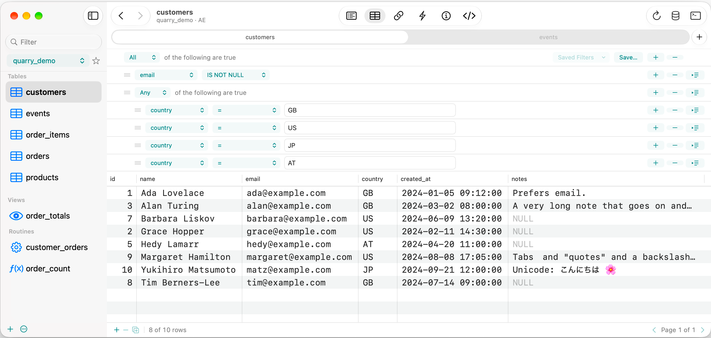
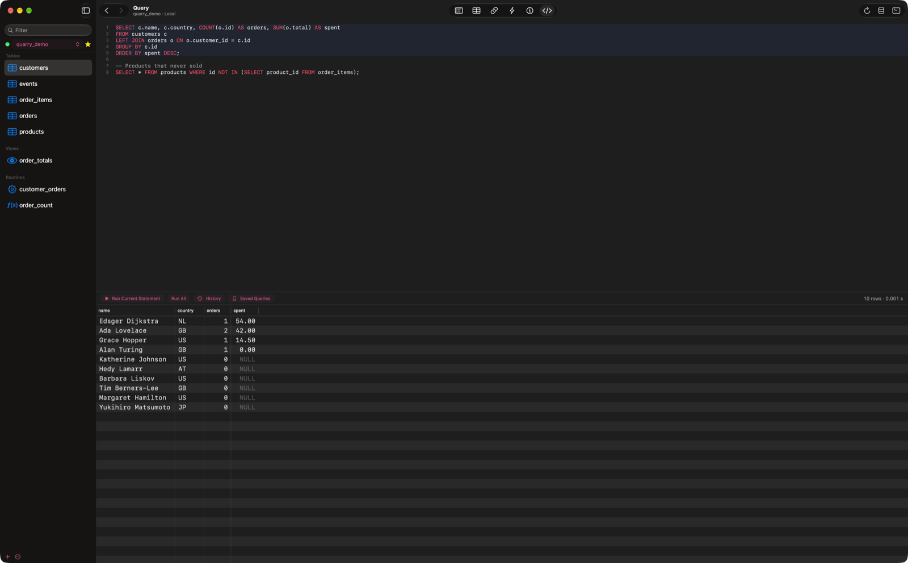
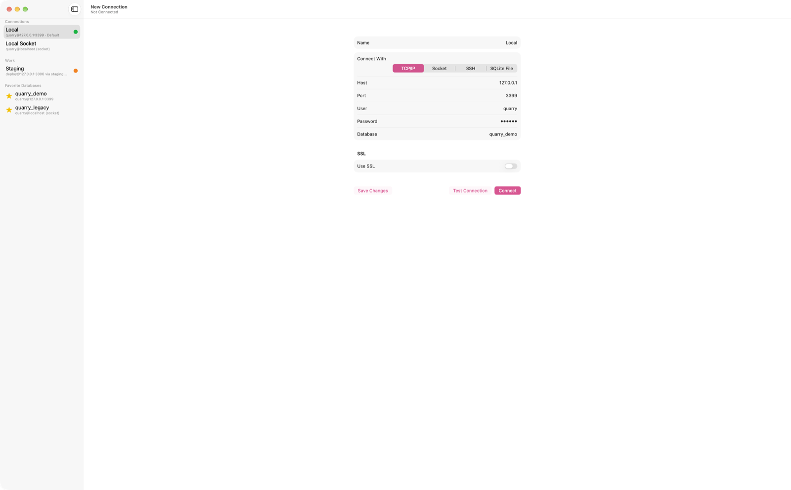

<p align="center">
  
</p>

<h1 align="center">Quarry Version 0.1</h1>

<p>
  A native macOS client for MySQL, MariaDB and SQLite, written in SwiftUI.<br>
  Connect via MCP with Claude, ChatGPT, Gemini, etc.<br> 
  Quarry would like to acknowledge <a href="https://github.com/sequelpro/sequelpro">SequelPro</a><br>
  Contact: <a href="https://www.linkedin.com/in/gary-ross/">Gary Ross</a>
</p>



## Download

**[Download the latest Quarry (.dmg)](https://github.com/garyross/Quarry/releases/latest)**

Open the DMG and drag Quarry to Applications. Quarry is signed and notarized by Apple, so it opens without warnings.
Needs macOS 26 or later on an Apple Silicon Mac. Earlier versions are on the [Releases](https://github.com/garyross/Quarry/releases) page.

## Features

**Connect**
- TCP/IP, Unix socket, SSH tunnel (password or key, host trust prompts) and SSL with client certificates
- SQLite files, opened read/write or read only, from the Connect form, File > Open… or a drop on the Dock
- Saved connections in groups with color tags, favorite databases, tabs (⌘T), and Sequel Pro `.spf` connection files and favorites
- Passwords live in the Keychain; Quarry's own data in a local SwiftData store

**Browse and edit data**
- Content with paging, sort, a quick filter (⌘F), nested All/Any/None filter rules, WHERE clauses and saved filters
- Inline editing, add/duplicate/delete rows, Set to NULL, a Field Editor for text, images and hex, and a Bit Editor
- Follow foreign keys with a click, and go Back/Forward through every table and view you visited
- Copy rows as tab-separated text, with column names, or as SQL INSERT statements

**Schema**
- Create, rename, duplicate, change and delete databases, tables, fields, indexes, foreign keys, triggers, views, procedures and functions
- Table Info (engine, character set, collation, auto increment, comment), Show Create Statement, and Check/Repair/Analyze/Optimize
- SQLite tables change by ALTER TABLE where it can, and otherwise by a safe table rebuild in one transaction

**Query**
- A SQL editor with highlighting, completions, comment and indent commands, and auto-closed brackets and quotes
- Run Current Statement or Run All, Cancel (⌘.), history, saved queries (in Sequel Pro's format) and editable results
- A Console that logs every statement Quarry sends

**Import and export**
- Export as SQL, CSV, JSON or XML, from tables, filtered content or query results, with file name tokens and one file per table
- Import SQL (also `.sql.gz`) and CSV with field mapping, or straight from the clipboard

**Server tools**
- Database Information with a Health Check, User Accounts and privileges, Server Variables, Server Processes with Kill
- SQLite file information: Integrity Check, Foreign Key Check, Analyze, Optimize and Vacuum

**Agents (MCP)**
- A built-in [Model Context Protocol](https://modelcontextprotocol.io) server lets AI agents such as Claude Code, Codex, Cursor and Claude Desktop query your saved connections
- Read only by default, with scoped tokens, per-change approval, and an activity log of every request
- One-click setup for each agent in Settings > MCP; see [MCP server](#mcp-server) below

Every command has a menu item and a keyboard shortcut; Help > Keyboard Shortcuts (⌘?) lists them all.



## MCP server

Quarry has a built-in [Model Context Protocol](https://modelcontextprotocol.io) (MCP) server. With it, an AI agent can list your saved connections, read schemas and run queries on your databases and SQLite files. You don't copy anything into the agent: it names a connection, and Quarry connects with the password it keeps in the Keychain. Passwords never reach the agent.

### Turn it on

1. Open **Quarry > Settings… > MCP** and turn on **Enable MCP server**. The status changes to "Running on 127.0.0.1:53306".
2. Under **Connect an Agent**, click **Add** next to your agent. Quarry knows these:

   | Agent | Config Quarry edits |
   | --- | --- |
   | Claude Code | `~/.claude.json` |
   | Codex | `~/.codex/config.toml` |
   | Cursor | `~/.cursor/mcp.json` |
   | Claude Desktop | `~/Library/Application Support/Claude/claude_desktop_config.json` |

   Quarry saves a `.quarry-backup` of the file first and changes only its own `quarry` entry.
3. Start a new session in the agent. Quarry's tools are there.

For any other client, **Manual Setup…** shows what to paste. Agents that start a local command (stdio) run Quarry's bridge, which starts Quarry in the background if it isn't open:

```sh
claude mcp add --scope user quarry -- ~/Applications/Quarry.app/Contents/MacOS/Quarry mcp
```

```json
{
  "mcpServers": {
    "quarry": {
      "command": "/Users/you/Applications/Quarry.app/Contents/MacOS/Quarry",
      "args": ["mcp"]
    }
  }
}
```

HTTP clients use `http://127.0.0.1:53306/mcp` and send a token from Settings > MCP > Tokens as `Authorization: Bearer <token>`.

### What agents can do

| Area | Tools |
| --- | --- |
| Connections | `list_connections`, `open_connection`, `close_connection` |
| Schema | `list_databases`, `list_tables`, `list_routines`, `describe_table`, `get_create_statement`, `table_sizes` |
| Data | `read_query`, `sample_rows`, `count_rows`, `explain_query` |
| Server | `server_info`, `list_processes` |
| Quarry | `list_saved_queries`, `query_history` |
| Changes | `write_query`, `kill_process` |

Agents can also read the front window's tables as resources (`quarry://{connection}/{database}/{table}`). There are three prompts: `analyze_schema`, `summarize_table` and `optimize_query`. When an agent leaves out the connection or database, Quarry uses the front window's.

### Safety

- **Off by default, and only on this Mac.** The server listens on 127.0.0.1 and on a Unix socket only you can open. It refuses requests from web pages.
- **Read only by default.** `read_query` runs one SELECT, SHOW, DESCRIBE, EXPLAIN or WITH at a time, inside a read-only transaction (on a SQLite file, over a read-only connection). It refuses anything that reads or writes server files, such as `INTO OUTFILE` and `LOAD_FILE`. On SQLite files, agents can't attach other files or load extensions.
- **Tokens.** Each agent can get its own token: Read Only, Read & Write, or Custom per connection, for all connections or only the ones you choose. Quarry shows a token once and keeps only its SHA-256 in the Keychain. You can revoke or delete a token at any time. Agents that use the stdio bridge share the Automatic token, which is Read Only until you change it.
- **You approve every change.** With **Ask before changes** on (the default), each `write_query` and `kill_process` opens an **Approve Agent Change** sheet with the exact statement. If no one answers in 2 minutes, the change is denied.
- **Its own connection.** Agents never use a window's connection. Quarry closes an agent's connection after 10 idle minutes and stops a query that runs over 300 seconds.
- **A record of everything.** Every agent statement shows in the Console. **Window > MCP Activity** (⌥⇧⌘M) lists each request with its client, token, tool, statement and result for 30 days, and exports them as CSV. Its Clients view disconnects an agent and stops its running query.

## Requirements

- macOS 26 or later, on an Apple Silicon Mac
- Swift 6.2 (Xcode 26 or the matching command line tools) to build

## Build

Quarry is a Swift package; there is no Xcode project.

```sh
./build.sh          # release build, signs it and installs ~/Applications/Quarry.app
./build.sh --open   # the same, then restarts Quarry with the new build
```

The build signs with your Apple Development certificate if you have one, and ad hoc otherwise.
Set `SIGN_IDENTITY` to choose a certificate.

### Release

```sh
./release.sh            # signed, notarized dist/Quarry-<version>.dmg
./release.sh --publish  # the same, then a GitHub release v<version> with the DMG
```

The version comes from `CFBundleShortVersionString` in `Info.plist.in`; bump it before each release.
Needs a Developer ID Application certificate and notary credentials; the top of `release.sh` has the one-time setup.

## Test

The tests run against a private MariaDB on 127.0.0.1:3399, never your own server.

```sh
tools/testdb.sh start                                              # creates and seeds the test server
swift test --scratch-path ~/Library/Developer/Quarry/test-build    # unit and integration tests
tools/selftest.sh                                                  # the app's real functions, end to end
tools/snap.sh                                                      # light and dark snapshots of every screen
```

The server tests skip when the test server isn't running. `tools/testssh.sh` starts a private sshd for the SSH tests.

## Project layout

| Path | What's there |
| --- | --- |
| `Sources/Quarry` | The app: windows, views, menus, and the AppKit grid and SQL editor |
| `Sources/QuarryControllers` | The window's controllers and sheet drafts, with no UI code |
| `Sources/QuarryKit` | Database client and drivers (MySQLNIO, SQLite), SQL rules, import/export, MCP |
| `Tests` | Unit and integration tests for QuarryKit and QuarryControllers |
| `tools` | Test servers, fixtures, self-test, snapshots and lint scripts |
| `docs` | Later |




## License

Quarry is released under the [MIT License](LICENSE).

## Acknowledgements

Quarry would like to acknowledge to [Sequel Pro](https://github.com/sequelpro/sequelpro) and the people who built it. It talks to MySQL and MariaDB with [MySQLNIO](https://github.com/vapor/mysql-nio) on [SwiftNIO](https://github.com/apple/swift-nio). The full list, with licenses, is in [Resources/Acknowledgements.txt](Resources/Acknowledgements.txt) and in Quarry's About window.
